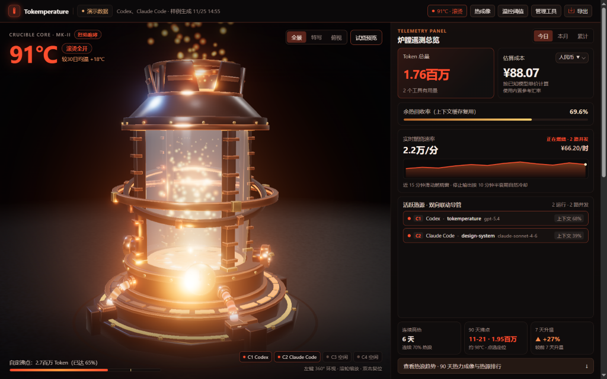

# Tokemperature · 算力坩埚

Tokemperature 是一款面向本机的 **AI 编程 Token 算力温度计与实时可视化看板**。它把枯燥的本地 Token 消耗转化为一座实时燃烧的三维重工暗铜石英坩埚（3D Crucible）——代码写得越密集、并发会话越多，炉温越高、火焰越烈，并在突破 `100°C` 沸点时燃起超高温蓝白电浆核心。



---

## 核心特性

- **65% 无边界 3D 算力坩埚 + 35% 遥测主栏**：首屏直观呈现 Blender 5.3 构建、Three.js + GLSL 实时渲染的透明石英反应坩埚（铸铁骨架、氧化红铜散热鳍片、双交叉旋转温控环、可开合顶冠百叶、侧面鼓风涡轮、黄铜指针表与 24 段底座沸点光环）。
- **6 层实时连续燃烧动画与 100°C+ 蓝白电浆芯**：炉膛 Voronoi 熔岩床 + 光线步进（Raymarched）3D 体积火焰 + 腔内/顶冠双 GPU 火星粒子 + 动态火光金属反射 + `ACESFilmic` 电影级色调映射与选择性 Bloom。支持 `22°C–125°C` 五档动态演进（「静默待机 / 正在预热 / 火力充沛 / 滚烫全开 / 沸腾破表」），`95°C+` 自动点亮蓝白电浆内芯。
- **双向联动输料导管与实时燃速**：监听本地 AI 编程会话活动（仅聚合工具名、项目名、模型、运行状态与上下文占比，不暴露会话标题或正文），4 路弧形燃料导管实时映射活跃热源并支持悬停双向高亮，搭配近 15 分钟滑动燃速与近 24 分钟波形图。
- **温阶试烧预览与视角控制**：支持鼠标左键 360° 环视、滚轮缩放、`全景 / 特写 / 俯视` 一键切换，以及右上角可折叠的「试烧预览」面板（`22°C–125°C` 滑块、五档快捷预览与「触发注能爆燃」）。
- **智能温控阈值与护眼模式**：支持按近 30 天均值自动校准或自定每日 Token / 人民币 / 美元沸点目标，达到 80% / 100% 时显示提醒并支持浏览器桌面通知；右上角可一键切换「热成像 / 护眼静谧」配色。
- **完整历史洞察与数据导出**：下滑查看 7 / 30 天热浪趋势、燃料构成、90 天热力成像日历，以及按工具、模型、项目统计的热源排行；支持人民币 / 美元切换与 CSV、JSON 导出。

---

## 完整部署与运行指南

### 1. 环境要求

- **Node.js**：`22.15.0` 及以上版本（推荐最新 LTS；内置 `node --test` 运行测试）
- **浏览器**：支持 WebGL2 的现代桌面浏览器（Chrome / Edge / Firefox；不支持 WebGL2 时自动降级展示静态高清渲染图）
- **网络与离线说明**：前端 Three.js 与 3D 模型已全量静态本地化，无需构建工具即可离线运行；仅在首次初始化本机扫描器时需联网下载固定版本的 `tokscale` 二进制校验包（演示模式 `--demo` 可完全离线运行）。

---

### 2. 获取项目源码

```bash
git clone https://github.com/leexxxinn/Tokemperature.git
cd Tokemperature
```

---

### 3. 部署方式

#### 方式一：快速样例演示（零配置立即体验）

适合首次体验全部 3D 火焰交互、试烧预览与图表界面，数据仅保存在内存中，不会修改本地磁盘记录：

```powershell
# Windows (PowerShell)
npm.cmd run demo
# 或指定自定义端口
npm.cmd run demo -- --port 17323
```

```bash
# macOS / Linux
npm run demo
# 或在只安装了 Node.js（未执行 npm install）时直接运行
node src/web/cli.js --demo --port 17323
```

启动后在浏览器访问 `http://127.0.0.1:17322`（或指定的端口）。

---

#### 方式二：Windows（PowerShell）本机部署

1. 若终端未将 Node.js 加入环境变量，可先确认 PATH 包含 Node 安装目录（通常为 `C:\Program Files\nodejs`）：
   ```powershell
   $env:PATH = "C:\Program Files\nodejs;$env:PATH"
   node -v
   ```
2. 安装依赖并预置扫描器：
   ```powershell
   npm.cmd ci
   npm.cmd run setup:scanner
   ```
3. 启动服务：
   ```powershell
   npm.cmd start
   ```
4. 浏览器打开 **`http://127.0.0.1:17322`**。首次启动会先恢复本地历史快照，并在后台完成本机扫描与文件变动监听；终端按 `Ctrl+C` 停止服务。

---

#### 方式三：macOS / Linux 本机部署

1. 安装依赖并预置固定版本的 Tokscale 扫描器：
   ```bash
   npm ci
   npm run setup:scanner
   ```
2. 启动服务：
   ```bash
   npm start
   ```
3. 浏览器打开 **`http://127.0.0.1:17322`**。

---

#### 方式四：环境变量与 `.env` 自定义配置

首次部署可复制项目根目录的 `.env.example` 为 `.env` 后按需修改：

```powershell
# Windows
Copy-Item .env.example .env
```

```bash
# macOS / Linux
cp .env.example .env
```

| 环境变量 | 默认值 | 说明 |
|---|---|---|
| `TOKEMPERATURE_PORT` | `17322` | 本地 HTTP 监听端口（`1–65535`）；也可用 `npm start -- --port 17325` 临时覆盖 |
| `TOKEMPERATURE_CLIENTS` | `codex,claude` | 尚未在网页保存工具列表时的初始采集工具，逗号分隔，例如 `codex,claude,opencode` |
| `TOKEMPERATURE_WATCH` | `1` | `1` 开启本地会话文件实时监听；设为 `0` 则仅按间隔定时扫描 |
| `TOKEMPERATURE_INTERVAL_MS` | `300000` | 两次定时扫描之间的毫秒数（范围 `15000–86400000`，默认 5 分钟） |
| `TOKEMPERATURE_SINCE` | `2024-01-01` | 累计统计的起始日期（格式 `YYYY-MM-DD`） |
| `TOKEMPERATURE_STATE_DIR` | `.data` | 本机用量快照、每日项目归档、设置与扫描器缓存目录；同时运行多个实例时请为每个实例指定独立目录 |
| `TOKEMPERATURE_WSL` | `0` | 设为 `1` 时启用上游对运行中 WSL 发行版日志目录的扫描（仅 Windows 环境有效） |

可用命令行参数（`node src/web/cli.js --help`）：
- `--port <端口号>`：覆盖监听端口
- `--demo`：以内存样例数据模式启动（不读写 `.data/` 目录）
- `--help`：查看命令行用法

---

#### 方式五：后台常驻运行（适合副屏长期挂载）

- **使用 PM2（Windows / macOS / Linux 通用）**：
  ```bash
  npm install -g pm2
  pm2 start src/web/cli.js --name tokemperature
  pm2 save
  ```
- **Windows PowerShell 后台静默拉起**：
  ```powershell
  Start-Process -WindowStyle Hidden -FilePath "C:\Program Files\nodejs\node.exe" -ArgumentList "src/web/cli.js" -WorkingDirectory (Get-Location)
  ```
- **Linux `systemd` 用户级服务（`~/.config/systemd/user/tokemperature.service`）**：
  ```ini
  [Unit]
  Description=Tokemperature Local Dashboard
  After=network.target

  [Service]
  Type=simple
  WorkingDirectory=/path/to/Tokemperature
  ExecStart=/usr/bin/node src/web/cli.js
  Restart=on-failure

  [Install]
  WantedBy=default.target
  ```
  启用并启动：`systemctl --user enable --now tokemperature`

---

## 日常使用说明

1. **管理采集工具**：点击顶部「管理工具」，可在 45 个受支持的 AI 编程工具中按名称或 ID 搜索并勾选采集对象；配置持久化在 `.data/tools.json`，停用后历史记录仍保留。
2. **温控与沸点设置**：点击顶部温度胶囊或「温控阈值」，可在「智能基线」与固定「Token / 人民币 / 美元」日目标间切换，设置持久化在 `.data/thermostat.json`。
3. **3D 炉体交互与试烧**：在左侧 3D 舞台拖曳可 360° 环视、滚轮缩放、双击复位视角；悬停右侧「活跃热源」卡片可联动点亮对应燃料导管 `C1–C4`；点「试烧预览」可拖动滑块快速预览全温阶及爆燃动画。
4. **币种与导出**：总览区默认以人民币（`CNY`）显示估算成本（支持每日汇率更新与离线参考汇率兜底），可随时切回美元（`USD`）；顶部「导出」菜单支持导出快照、每日用量、每日模型 CSV 及完整 JSON（导出成本字段统一使用美元）。

---

## 开发、测试与 3D 资产重建

- **运行全部单元测试与 HTTP 接口验证**：
  ```bash
  npm test
  ```
- **更新本地离线 Three.js 运行时**（修改依赖版本后从 `node_modules/three` 重新提取并重写 ESM 导入路径）：
  ```bash
  node scripts/vendor-three.js
  ```
- **重建 3D 坩埚 `.glb` 模型与降级静态图**（需安装 Blender 5.3）：
  ```powershell
  & "M:\Software\Blender\blender.exe" -b --python scripts/build-crucible-3d.py
  ```
  模型源文件保存在 `assets/blender/tokemperature-crucible.blend`，导出产物位于 `src/web/public/assets/crucible-reactor.glb` 与 `crucible-fallback.png`。

---

## 数据安全与开源致谢

- **本地安全边界**：服务仅绑定 `127.0.0.1`，严格校验 `Host` 与同源 `PUT` 请求，配置严格 CSP（`default-src 'self'`）；前端网页及导出数据仅包含用量统计、模型与项目标签，会话正文与账号凭据始终留在本机采集来源目录。
- **上游致谢**：`src/shared/` 与 `src/hub/` 中的用量采集与聚合模块来自 [Token Monitor](https://github.com/Javis603/token-monitor) `0.97.0`（固定在提交 `e8e028dbe95885399c2a8e5eb7bfa48a1bbc73bd`），基于 MIT 协议开源，完整许可文本见 [LICENSE](LICENSE)。
